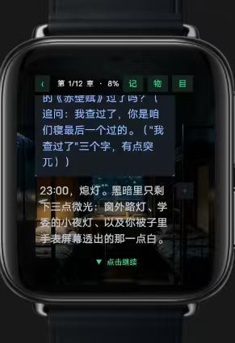
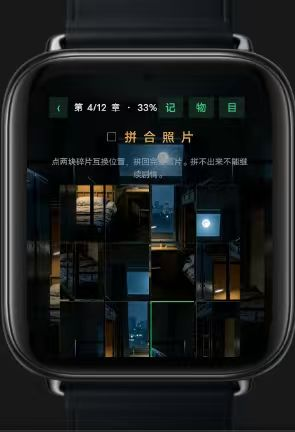
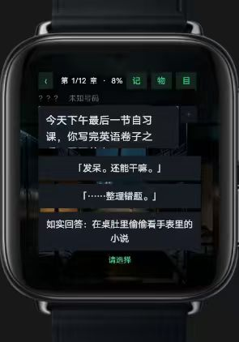
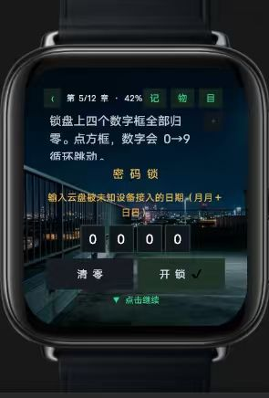
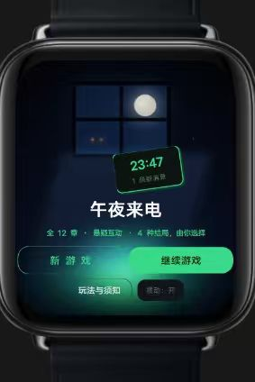

# 午夜来电 🌙⌚

一款专为智能手表打造的**悬疑互动游戏**（vivo 手表快应用）。深夜 23:47，一条来电打破了寂静——你的黑夜，从此不再属于你自己。

## 游戏截图

| 标题画面 | 剧情推进 | 关键抉择 |
|:---:|:---:|:---:|
|  |  |  |

| 密码锁谜题 | 拼合照片 |
|:---:|:---:|
|  |  |

## 玩法特色

- **全 12 章悬疑剧情**：从晚自习的窃窃私语，到午夜的街头与窗灯，一步步揭开来电背后的秘密
- **分支抉择**：回复消息、接不接电话、说不说真话——你的选择决定故事的走向
- **多线结局**：多种路线由你选择，每次重玩都可能遇到不一样的真相
- **原创谜题**：密码锁、拼合照片等手谜穿插剧情，转动数字框、点击碎片，解开隐藏在回忆里的线索
- **收集要素**：记 / 物 / 目 三类收集品，章节进度与收集度实时显示，全收集等你挑战
- **沉浸氛围**：深夜、路灯、小雨、小夜灯——为手表小屏精心调制的暗色氛围画面

## 下载安装

在手机或手表的快应用环境中打开本仓库的 [com.midnightcall.watchgame.debug.production.0.4.0.rpk](com.midnightcall.watchgame.debug.production.0.4.0.rpk) 即可安装（手表版 v0.4.0，调试签名包）。

> 💡 建议佩戴耳机或调大音量，深夜游玩效果更佳。

---

*23:47，一条新来电。接，还是不接？*
